# Phase 2 Authentication Flows

## Flow Diagrams

### 1. Signup Flow

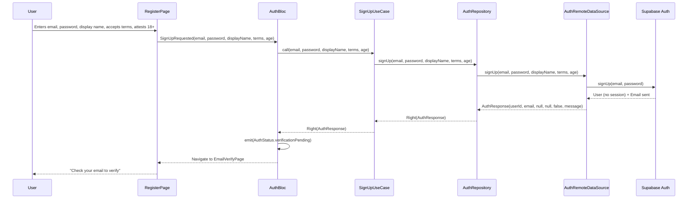

### 2. Email Verification Flow

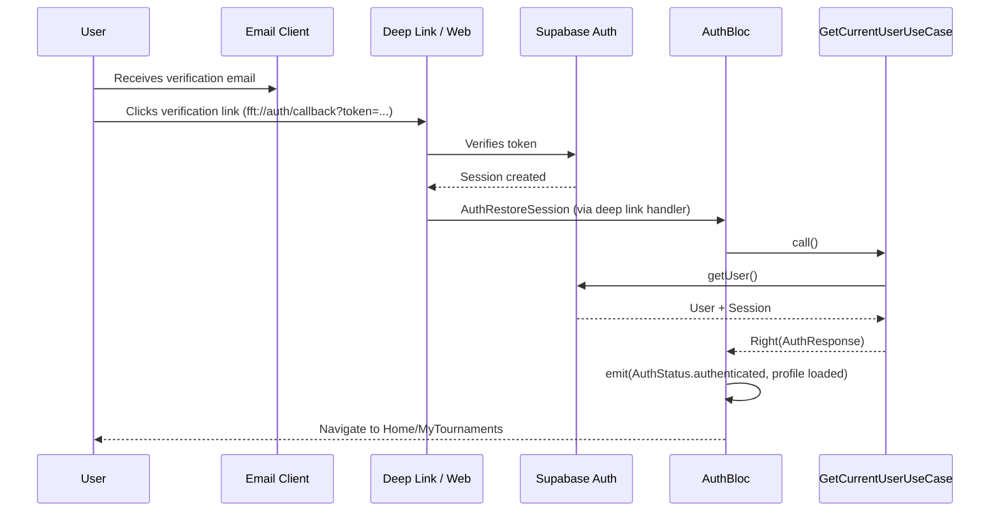

### 3. Login Flow

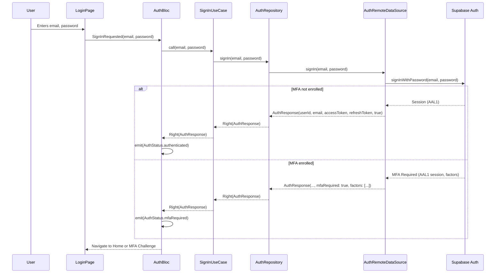

### 4. MFA Challenge Flow

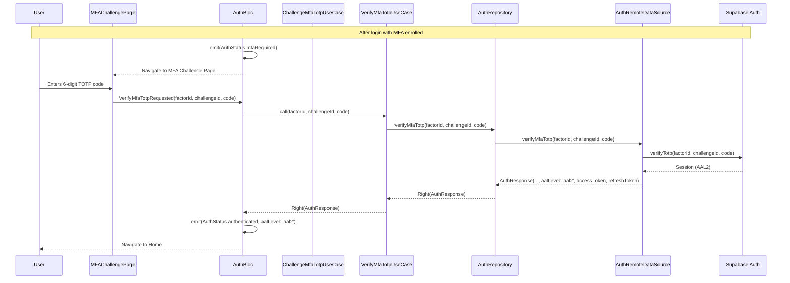

### 5. Password Reset Request Flow

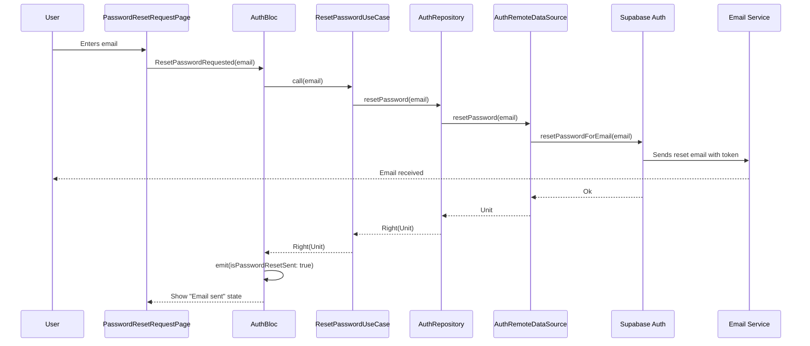

### 6. Password Reset Confirm Flow

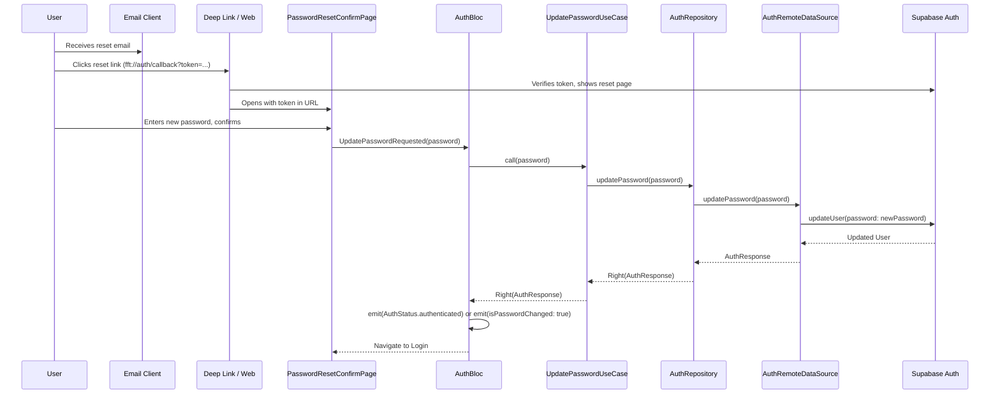

### 7. Profile Management Flow

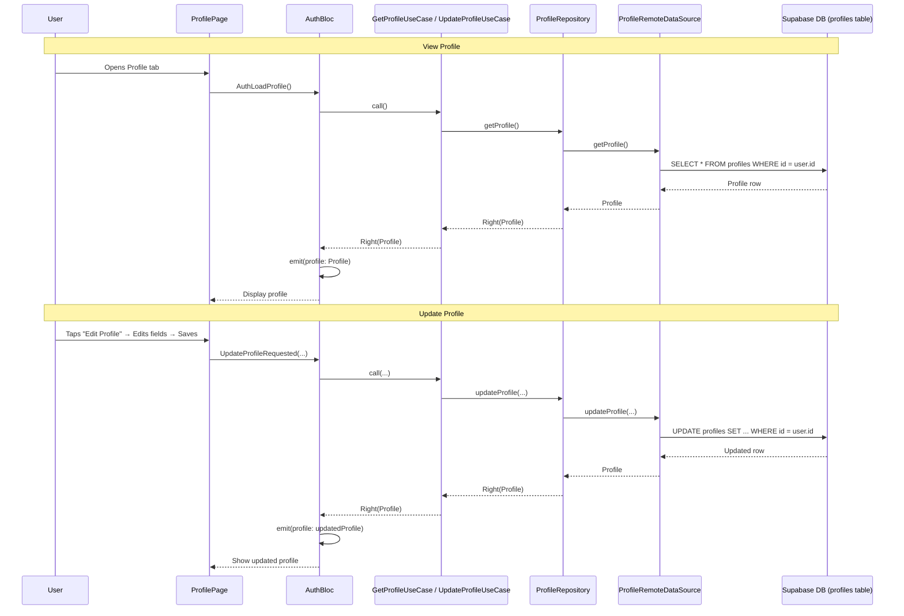

### 8. MFA Enrollment Flow

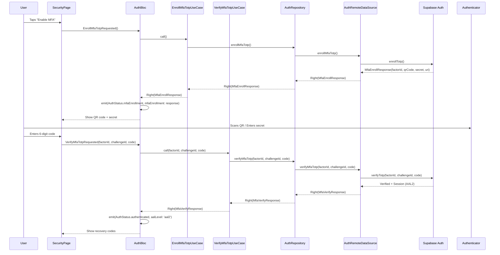

### 9. Account Deletion Flow

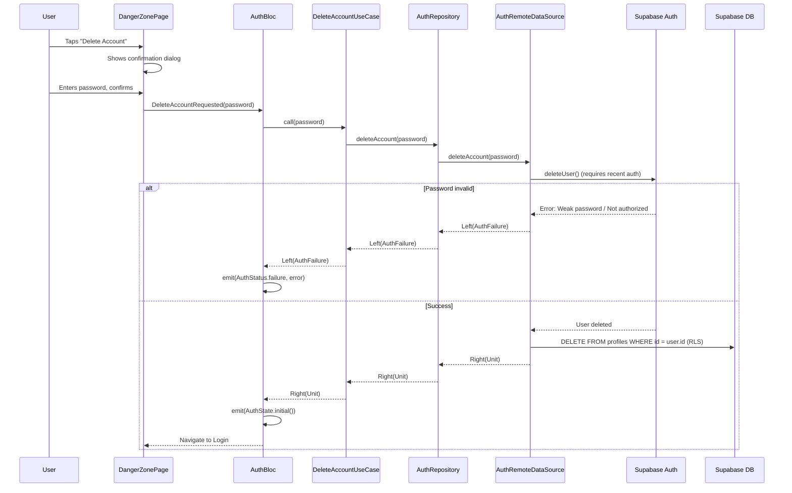

### 10. Session Restoration Flow

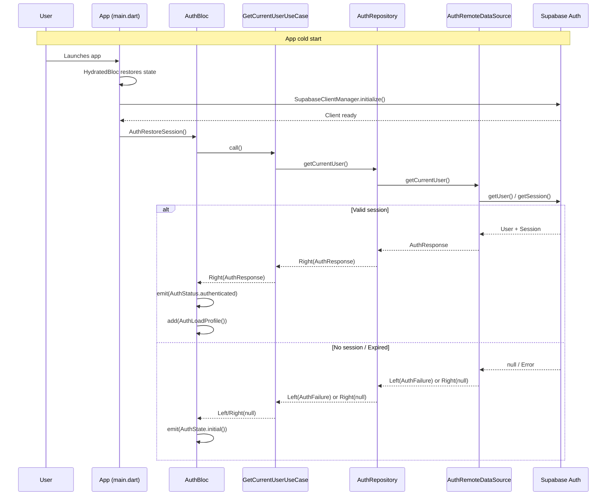

## Screen State Machines

### Login Page

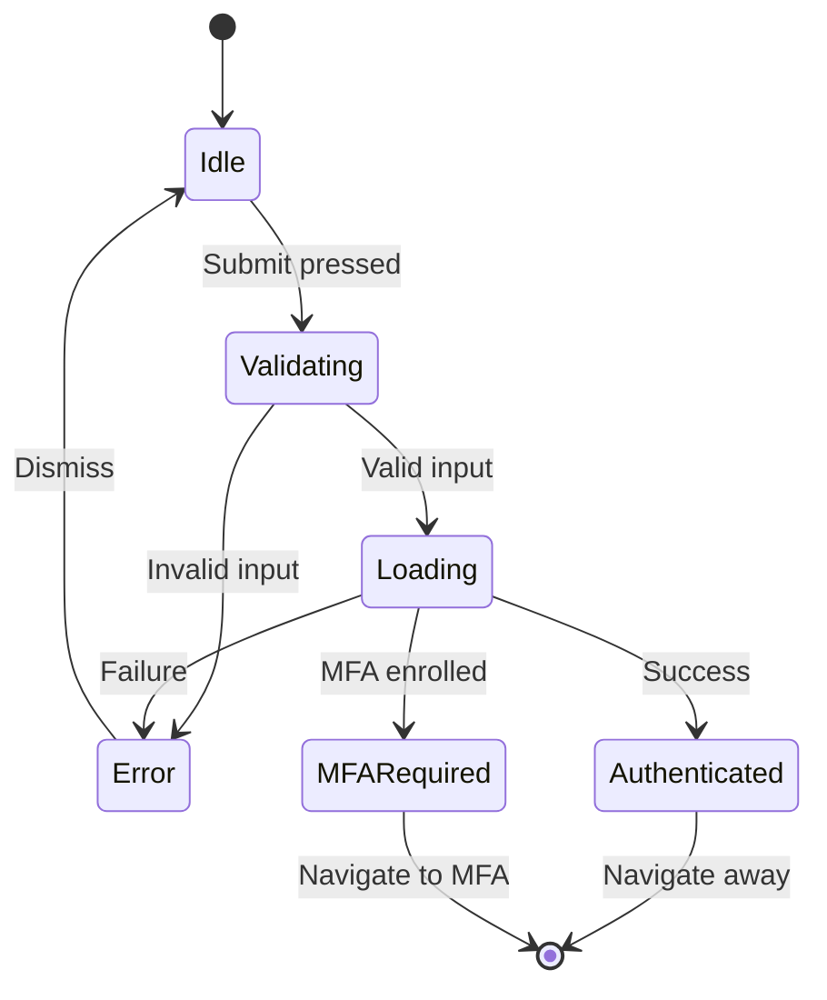

### Register Page

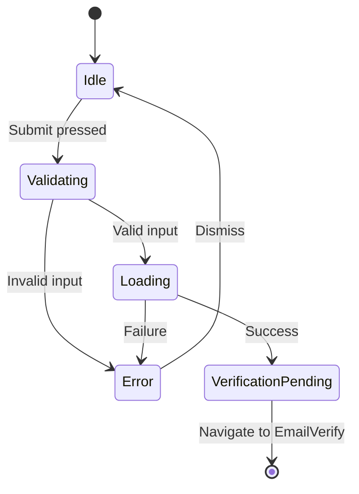

### Email Verify Page

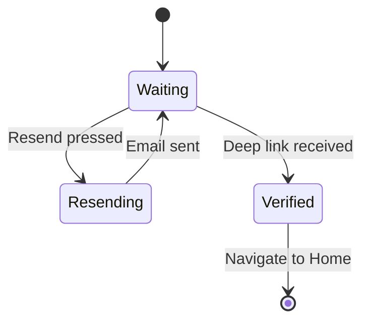

### Password Reset Request

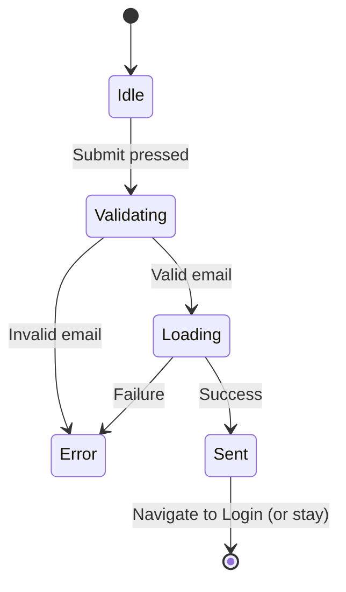

### Password Reset Confirm

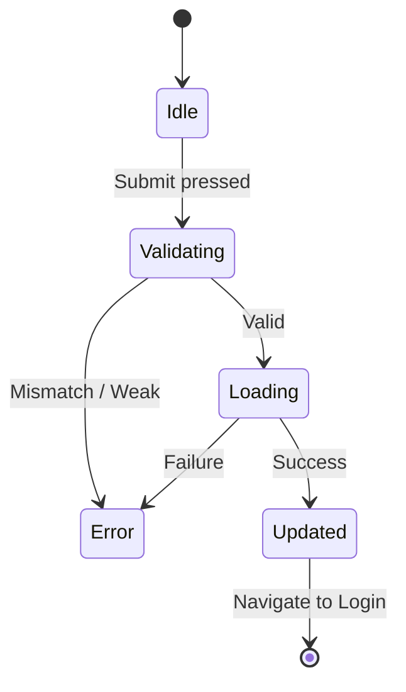

### MFA Enrollment

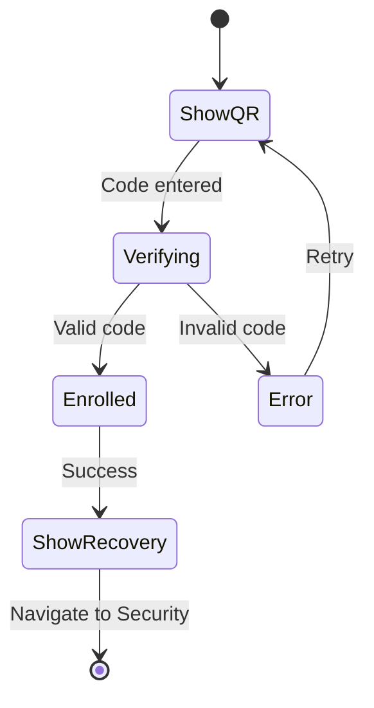

### MFA Challenge

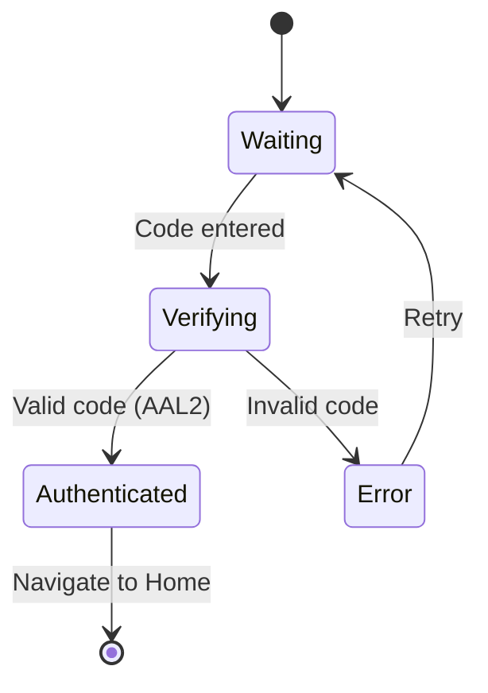

### Profile Page

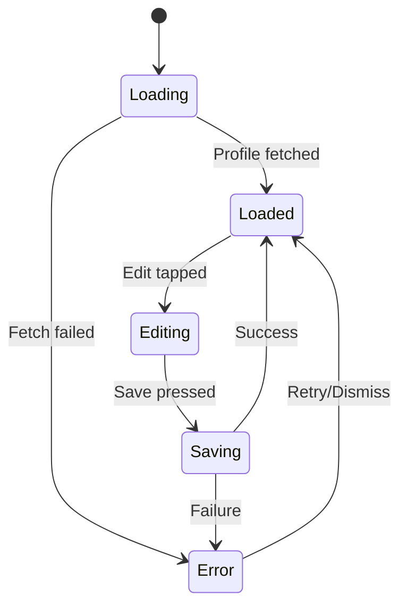

## Error States

| Screen | Error Type | Message | Action |
|---|---|---|---|
| Login | Invalid credentials | "Invalid email or password" | Retry |
| Login | Email not verified | "Please verify your email first" | Go to EmailVerify |
| Login | MFA required | (Navigate to MFA) | Auto-navigate |
| Register | Email exists | "An account with this email already exists" | Go to Login |
| Register | Weak password | "Password must be at least 8 characters" | Fix input |
| Email Verify | Expired link | "This link has expired. Request a new one." | Resend |
| Email Verify | Invalid link | "This verification link is invalid" | Resend |
| Password Reset | Expired token | "This reset link has expired" | Request new |
| Password Reset | Invalid token | "This reset link is invalid" | Request new |
| Password Change | Wrong password | "Current password is incorrect" | Retry |
| Email Change | Pending | "Confirmation sent to new email" | Check email |
| MFA Enrollment | Invalid code | "Invalid code. Try again." | Retry |
| MFA Challenge | Invalid code | "Invalid code. Try again." | Retry |
| MFA Challenge | Rate limited | "Too many attempts. Wait before retrying." | Wait |
| Account Delete | Wrong password | "Password is incorrect" | Retry |
| Account Delete | Network error | "Could not delete account. Try again." | Retry |
| Profile Update | Username taken | "This username is already taken" | Choose another |
| Network | Offline | "No internet connection. Please try again." | Retry |
| Server | 5xx | "Server error. Please try again later." | Retry |

## Loading States

| Screen | Loading Indicator | Disabled Elements |
|---|---|---|
| Login | Button spinner | Email, password, submit |
| Register | Button spinner | All fields, submit |
| Email Verify | Button spinner (resend) | Resend button |
| Password Reset Request | Button spinner | Email, submit |
| Password Reset Confirm | Button spinner | Passwords, submit |
| MFA Enrollment | None (QR static) | Verify button |
| MFA Challenge | Button spinner | Code field, submit |
| Password Change | Button spinner | All fields, submit |
| Email Change | Button spinner | Email, submit |
| Account Delete | Button spinner | Password, confirm, delete |
| Profile | Inline spinner (avatar) | Save button |

## Accessibility

- All form fields have labels
- Error messages announced via `Semantics`
- Focus order logical (top to bottom)
- Color contrast meets WCAG AA
- Touch targets ≥ 48dp
- Screen reader tested (TalkBack, VoiceOver)

## Deep Link Handling

```dart
// main.dart
GoRouter(
  routes: [
    GoRoute(
      path: '/auth/callback',
      builder: (context, state) {
        final token = state.uri.queryParameters['token'];
        final type = state.uri.queryParameters['type'];
        // Handle verification, password reset, MFA
        return AuthCallbackPage(token: token, type: type);
      },
    ),
  ],
)
```

## Platform-Specific Notes

### Android
- `flutter_deep_linking` for app links
- `android:autoVerify="true"` for verified links
- `assetlinks.json` for domain verification

### iOS
- `Associated Domains` entitlement
- `apple-app-site-association` file
- Universal Links for seamless experience

### Web
- Supabase handles OAuth redirects
- PKCE flow for security
- No deep linking needed (same origin)

## Rate Limits (Supabase Defaults)

| Operation | Limit | Window |
|---|---|---|
| Sign up | 3 | hour |
| Sign in | 10 | hour |
| Password reset | 3 | hour |
| Email verification | 3 | hour |
| MFA enroll | 5 | hour |
| MFA verify | 10 | minute |
| Token refresh | 10 | minute |

Client-side: Debounce form submissions (500ms), disable buttons during loading.

## Migration Notes

When adding new auth features:
1. Add event to `AuthEvent`
2. Add state field to `AuthState`
3. Add handler in `AuthBloc`
4. Create use case
5. Add repository method
6. Add data source method
7. Add UI screen
8. Add route in `AppRoutes`
9. Write tests
10. Update this document